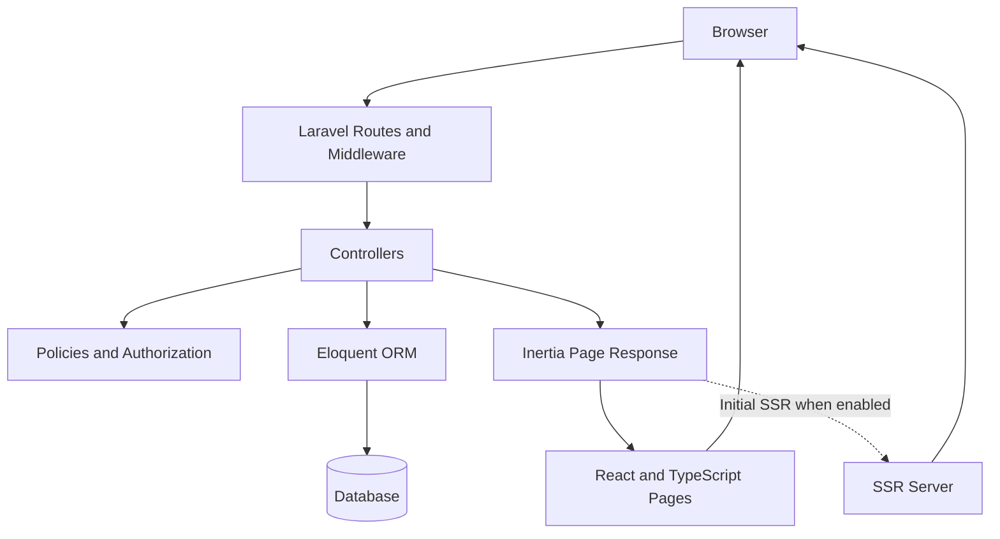

# Feature Voting Platform

A full-stack platform for collecting feature requests, prioritizing ideas through community voting, and managing discussions with role-based access control.


## Overview

The platform helps software teams collect user feedback and make informed product decisions. Users can submit feature requests, vote on ideas, and participate in discussions according to their permissions.

## Features

- User registration, authentication, and email verification.
- Feature request creation, browsing, editing, and deletion subject to authorization.
- Upvoting and downvoting feature requests.
- Comment management with permission-based access.
- User and role management.
- Server-side authorization using Laravel policies and Spatie Laravel Permission.
- Toast notifications for application feedback.
- React and TypeScript frontend integrated with Laravel through Inertia.js.

## Technology Stack

| Layer | Technologies |
| --- | --- |
| Backend | PHP, Laravel, Eloquent ORM |
| Frontend | React, TypeScript, Tailwind CSS |
| Integration | Inertia.js |
| Authorization | Laravel Policies, Spatie Laravel Permission |
| Build tooling | Vite, Composer, npm |
| Rendering | Inertia SSR architecture |

## Architecture

The application uses Laravel as the backend and React as the presentation layer. Inertia.js connects both layers without requiring a separate REST API for page navigation.



## Getting Started

### Prerequisites

- PHP and Composer
- Node.js and npm
- A database supported by the application configuration

Check `composer.json` and `package.json` for the project's dependency and runtime requirements.

### Local Installation

Clone this repository using its GitHub clone URL, then open a terminal in the project directory.

```bash
composer install
npm ci
```

Create the local environment file:

```bash
cp .env.example .env
```

On Windows PowerShell, use `Copy-Item .env.example .env` instead.

Generate the application key:

```bash
php artisan key:generate
```

Configure the database connection in `.env`, then run:

```bash
php artisan migrate
```

If the project provides seeders for roles and permissions, review them before running the appropriate seeding command.

### Run the Application

Start Laravel in one terminal:

```bash
php artisan serve
```

Start Vite in a second terminal:

```bash
npm run dev
```

Open [http://localhost:8000](http://localhost:8000).

### Server-Side Rendering

Inertia SSR allows the initial React page to be rendered on the server before client-side hydration. Subsequent Inertia navigation can update the page without a full browser reload.

SSR requires a configured server entry point, a compatible build script, and a running SSR process. Consult the project's Vite configuration and npm scripts before enabling it in production.

## Security

- Authentication identifies users, while authorization controls permitted actions.
- Laravel policies and role-based permissions enforce access on the backend.
- Frontend permission checks improve the user experience but do not replace backend authorization.
- Environment variables and credentials must remain outside version control.
- Configure mail credentials locally when testing email verification.

## Testing

Run the configured Laravel test suite with:

```bash
php artisan test
```

Recommended coverage includes authentication, feature ownership, voting behavior, comment permissions, and administrative access.

## Deployment Roadmap

- [ ] Deploy the application to a VPS.
- [ ] Configure the production database and environment.
- [ ] Build frontend assets and verify SSR in production.
- [ ] Configure HTTPS and the web server.
- [ ] Automate deployment using GitHub Actions.

## Author

Developed by [bakr1-it](https://github.com/bakr1-it).
